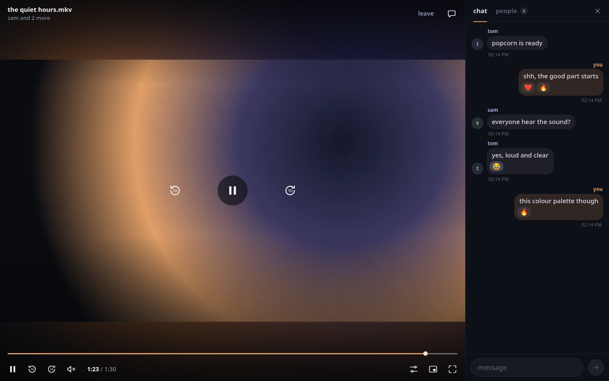
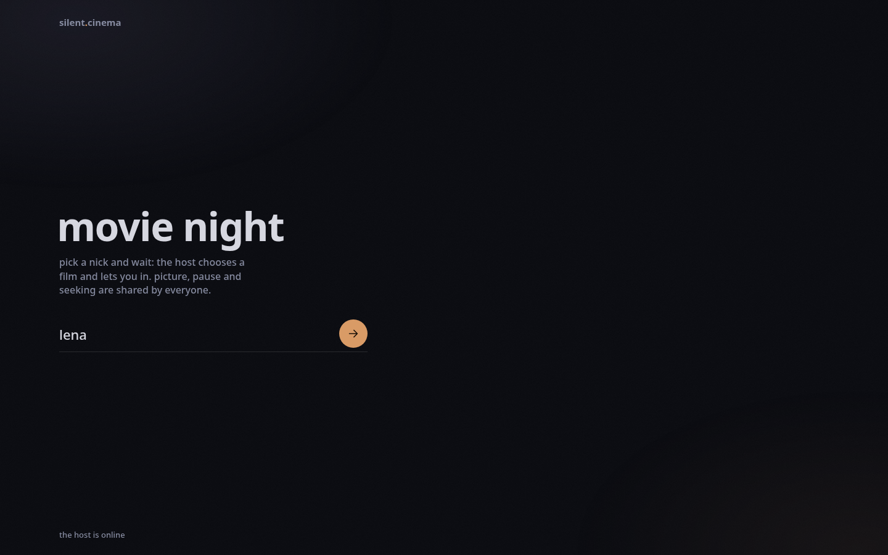
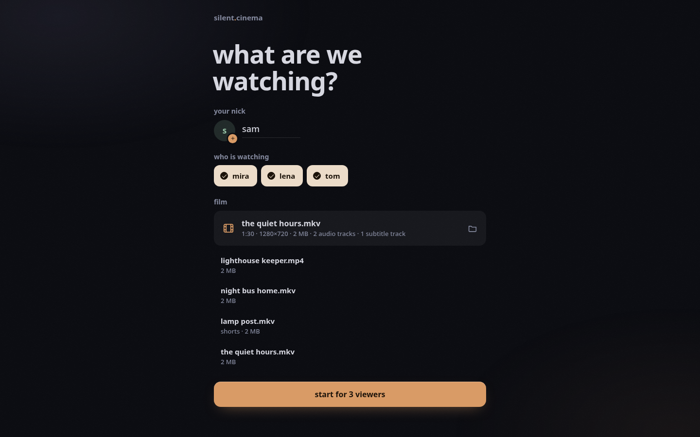
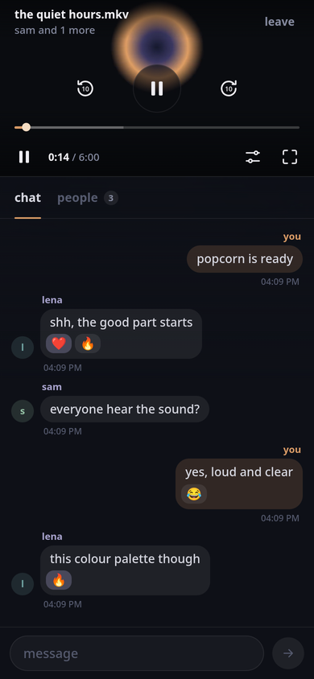

# silent.cinema

a self-hosted watch party. you put a video file on your own server, open the host page, and the friends you let in watch it with you in sync: one shared pause, one shared seek bar, a chat with replies and reactions. think of rave, except the film never leaves your machine and nobody needs an account.



## what it does

- plays any file ffmpeg can read (mkv, mp4, mov, webm, avi, ts, m2ts and more) in the browser as hls. nothing is converted up front: a session is ready a second or two after the start button, segments are cut on demand.
- h264 video is sent bit for bit as the "original" quality. hevc, av1, 10-bit and blu-ray remuxes whose keyframes a browser cannot start from get an x264 level of at most 1080p instead. 720p and 480p levels are added for slow lines when the source is taller.
- every viewer picks their own audio track, subtitles (text tracks, extracted to webvtt) and quality.
- the server owns the playback clock. clients estimate the server time from ping round trips and follow it with rare, small corrections: a single 3 % rate change for small offsets, a jump only beyond 1.2 s. in a test with two real browsers the pictures were 16 to 55 ms apart.
- up to 40 viewers per room by default. the host decides per person who may pause and seek, lets latecomers in or removes people.
- chat with replies, reactions, "is typing", avatars, unread counts and notification cards over the picture.
- built for phones too: picture on top and chat below when upright, full screen picture when sideways, media session buttons, screen wake lock, safe areas and on-screen keyboards handled.
- survives restarts and flaky networks: the room, position and chat are saved to disk, clients reconnect by themselves, and open pages reload themselves after an update and continue at the same frame.
- english and russian interface, picked from the browser language or `?lang=en` / `?lang=ru`.

| join | host | phone |
| --- | --- | --- |
|  |  |  |

## how it works

the server has two listeners:

- the public one (`PORT`, default `8080`) serves the viewer page, the websocket and the stream. put it behind a reverse proxy with https, or give it a certificate directly.
- the host one (`HOST_PORT`, default `8088`) serves the host page at `/host`. it binds to `127.0.0.1` by default, so only someone on the server itself (or with an ssh tunnel to it) can be the host. the host role does not exist on the public listener at all.

the host chooses the film from the film folder (`MEDIA_DIR`) on the server, or, on a linux desktop, in the system file dialog on the server's own screen. the browser never uploads anything, and the host page can only start files the server itself listed.

each person in the room gets their own random key to the stream. removing someone revokes their key at once.

## requirements

- linux or macos. on windows run it in docker or wsl2: the server relies on `nice` and on pausing ffmpeg with `SIGSTOP`.
- node.js 22 or newer
- ffmpeg and ffprobe on the `PATH`
- optional: `zenity` for the desktop file dialog
- cpu: 8-bit h264 is copied and costs almost nothing. hevc, av1, 10-bit and some blu-ray remuxes are encoded to x264 while you watch: on a desktop cpu a 5.6 s segment of the 1080p level takes about 1.1 s, so a small vps will struggle with that. files without a matroska index (most mp4 and avi) need a keyframe scan of a few seconds before the start.
- upload bandwidth: every viewer gets their own copy of the stream, so the number of viewers is roughly your upload speed divided by the film's bitrate. an 18 mbit/s film on a 480 mbit/s line is about 20 viewers with headroom; viewers on the 720p level need about 4 mbit/s each.

## quick start

```sh
git clone https://github.com/waydef/silent-cinema.git
cd silent-cinema
npm ci --omit=dev
MEDIA_DIR=~/Videos npm start
```

open `http://127.0.0.1:8088/host` on the same machine, and send your friends the public address (`http://<server>:8080` for a quick lan test). they type a nick, you pick a film and press start.

## docker

```sh
git clone https://github.com/waydef/silent-cinema.git
cd silent-cinema
mkdir films        # put the videos here
docker compose up -d --build
```

`compose.yaml` publishes the viewer port on `8080` and the host port on `127.0.0.1:8088` of the docker host. the room state lives in the `data` volume. to host from your laptop while the server is somewhere else, tunnel the host port:

```sh
ssh -L 8088:127.0.0.1:8088 your-server
```

and open `http://127.0.0.1:8088/host` locally.

## going public

use https for anything beyond a lan test: browsers keep the screen awake (wake lock) only on secure pages, and nicks and chat should not travel in the clear. the simplest way is a reverse proxy:

- caddy: [deploy/Caddyfile](deploy/Caddyfile), two lines, certificates included
- nginx: [deploy/nginx.conf](deploy/nginx.conf)

run silent.cinema with `BIND=127.0.0.1` and `TRUST_PROXY=1` behind either of them, and set `PUBLIC_HOSTS` and `PUBLIC_URL` to your domain. without `TRUST_PROXY` every viewer arrives from the proxy's address and shares its limits, so the 13th person gets "too many tabs from one address"; the server logs a hint when it sees this. `TRUST_PROXY` takes the last `x-forwarded-for` hop, so with two proxies in a row (a cdn in front of nginx) the first one has to restore the real address.

there is no room password. strangers who find the address can only wait in the lobby until you let them in, unless you switch on "let latecomers in right away": keep that off on a public address. https names end up in public certificate transparency logs, so assume the address will be found.

without a proxy, give the server a certificate with `TLS_CERT` and `TLS_KEY`. a renewed certificate is picked up on `SIGHUP` (`systemctl reload silent-cinema`) without dropping anyone.

a systemd unit with sandboxing is in [deploy/silent-cinema.service](deploy/silent-cinema.service).

## configuration

everything is set through environment variables; [.env.example](.env.example) lists them with comments.

| variable | default | meaning |
| --- | --- | --- |
| `PORT` | `8080` | public listener for viewers |
| `BIND` | `0.0.0.0` | address of the public listener; `127.0.0.1` behind a local proxy |
| `TLS_CERT`, `TLS_KEY` | empty | certificate chain and key; when both are set the public listener speaks https |
| `PUBLIC_HOSTS` | empty (any) | comma separated host names the public listener answers to; others get `421` |
| `PUBLIC_URL` | `https://` + first of `PUBLIC_HOSTS` | the address shown on the host page |
| `TRUST_PROXY` | off | `1`: take the client address from the last `x-forwarded-for` hop. only enable it when the proxy is the only way to the public port |
| `HOST_PORT` | `8088` | host listener |
| `HOST_BIND` | `127.0.0.1` | address of the host listener |
| `HOST_HOSTS` | empty | extra host names for the host listener, when it is bound to a lan address |
| `PICKER` | `auto` | `library`: the film folder; `dialog`: the desktop file dialog; `auto`: the folder when it exists, the dialog when a display and `zenity` are there |
| `MEDIA_DIR` | `~/Videos` | the film folder, scanned recursively (6 levels, hidden entries skipped) |
| `ZENITY` | `zenity` | file dialog command |
| `STATE_DIR` | `~/.local/state/silent-cinema` | the saved room and the avatars |
| `CACHE_DIR` | `~/.cache/silent-cinema` | stream segments of the running session, wiped at start and at the end of a session |
| `MAX_VIEWERS` | `40` | people in one room |
| `HOST_NAME` | `host` | the host's nick until they change it on the host page |

## keyboard

| key | action |
| --- | --- |
| space, `k` | play or pause |
| left, right, `j`, `l` | 10 s back or forward, with shift 60 s |
| up, down | volume |
| `m` | mute |
| `f` | full screen |
| `c` | chat |

on phones a double tap on the left or right third of the picture skips 10 s.

## protection against abuse

the public listener is meant to face the internet:

- `/host`, `/api/probe` and the host websocket answer `404` on it. the host listener only accepts loopback host names, so a dns rebinding page cannot reach it either.
- websockets must come from the same origin.
- a viewer page solves a small proof of work (about 16 thousand sha256 rounds, tens of milliseconds) before it may take a nick.
- per address and minute: 240 plain http requests, 40 websocket connections, 20 joins; at most 12 viewers and 24 websockets per address at once. stream segments are not counted.
- 20 messages a second per connection, 8 kb per frame, a chat burst of 6 messages and then one every 1.2 s.
- the page has a strict content security policy, `x-robots-tag: noindex` and a `robots.txt` that disallows everything.

see [SECURITY.md](SECURITY.md) for how to report a vulnerability.

## development

```sh
npm ci
npm run check    # syntax of every file
npm test         # end to end tests, needs ffmpeg for the streaming one
```

the tests start a real server on free ports with a temporary film folder. the code is plain node and browser javascript without a build step: `server.js` (rooms, clock, http and websocket), `stream.js` (keyframe index, hls playlists, ffmpeg jobs) and `public/` (pages, player, sync, chat, translations in `public/i18n.js`). [CONTRIBUTING.md](CONTRIBUTING.md) has the details.

## known limits

- hdr sources are not tone mapped.
- image subtitles (pgs, dvd, dvb) are skipped; only text tracks are offered.
- the chat history ends with the session.
- safari and ios use native hls. audio switching goes through `video.audioTracks` there and the quality list is hidden. this path was not verified on real apple devices.
- the transcoded top level for hevc, av1 and 10-bit sources has not been tested with a real file of each kind.

## license

mit, see [LICENSE](LICENSE). the reaction emoji are google's animated noto emoji under cc by 4.0, and the player uses hls.js under apache 2.0; see [NOTICE.md](NOTICE.md).

## кратко на русском

silent.cinema: совместный просмотр фильмов на своём сервере, аналог rave без чужих серверов и регистрации. хост выбирает файл из папки на сервере, друзья открывают сайт, вводят ник и смотрят синхронно: общая пауза и перемотка, чат с ответами и реакциями, своя озвучка, субтитры и качество у каждого. интерфейс на русском и английском (`?lang=ru`). запуск: `MEDIA_DIR=~/Videos npm start` или `docker compose up -d`, страница хоста `http://127.0.0.1:8088/host`.
